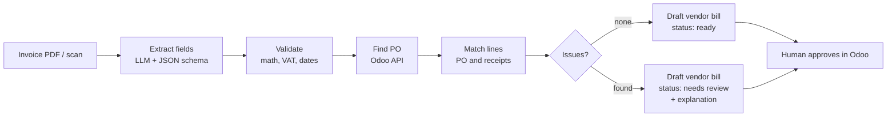

# Invoice Match Agent

An AI accounts-payable agent that plugs into an **Odoo ERP**. It reads supplier invoices (clean PDFs, scans, phone
photos), finds the matching purchase order, checks the invoice against **what was ordered and what was actually
received** (3-way match), explains every mismatch and creates a **draft vendor bill** for a person to approve.

> Built against a self-hosted Odoo 19 Community instance with a fictional company and synthetic invoices.
> No real company data.

**Held-out result** (40 unseen invoices, scored once, no changes afterwards):

| | |
|---|---|
| Problem invoices sent to review | **28/28 (100%)** |
| Planted errors caught (all 8 types) | **32/32 (100%)** |
| Flags that were real | 32/33 (97%) |
| Correct final status | **39/40 (98%)** |
| Median time per invoice | ~2.7 s |

The one miss was a Google API timeout on a clean invoice, which the agent safely sent to a person.

## The problem

Finance teams pay suppliers by checking three documents against each other:

| Document | Says |
|---|---|
| **Purchase order (PO)** | What we agreed to buy, at what price |
| **Goods receipt** | What actually arrived at the warehouse |
| **Supplier invoice** | What the supplier is charging us |

If they don't match, the company can overpay: billed for 50 units when 40 arrived, a price higher than agreed,
the same invoice paid twice. Checking this by hand is slow, and mistakes cost real money.

Odoo has basic 3-way matching built in, but only on **quantities**, and only **after** someone has typed the invoice
in by hand. This agent does the part before that, and checks more:

- reads invoices in any layout, including scans and photos
- finds the right PO even when the invoice has no PO number or a wrong one
- matches invoice lines to PO lines when product names differ ("Coke 1.5L x12" vs "Coca-Cola 1.5 L Case")
- checks quantities **and** unit prices, totals, VAT and duplicates
- explains each issue in plain language and never posts or pays anything on its own

## How it will work



## What counts as an issue

| Check | Example |
|---|---|
| Over-billed quantity | Invoiced 50, received 40 |
| Price mismatch | ₱1,200/unit vs ₱1,000 on the PO |
| Unknown item | Invoice line not on the PO |
| Wrong or missing PO | PO number absent, or belongs to another supplier |
| Duplicate invoice | Same supplier + invoice number (or same amount and date) already billed |
| Math / VAT error | Line totals or 12% VAT don't add up |
| Not yet received | Invoice arrives before any goods receipt |

## Evaluation plan

Synthetic invoices generated from the Odoo POs, with **planted errors** from the table above, in several layouts
(clean PDF, scanned, phone photo, multi-page). Each invoice has an answer key.

| Metric | Meaning |
|---|---|
| Field extraction accuracy | Supplier, invoice no., date, PO no., lines, totals read correctly |
| PO match accuracy | Linked to the right PO |
| Issue recall | % of planted errors caught |
| Issue precision | % of flagged issues that are real (false alarms waste time) |
| Clean pass rate | % of correct invoices that go through with no false flags |
| Latency and cost | Per invoice |

Same approach as [inquiry-triage-automation](https://github.com/hokors/inquiry-triage-automation): a tuning set to
improve on, a held-out set scored once.

## Test invoices

[`generator/`](generator/) builds supplier invoices from Lakan's actual POs and goods receipts in Odoo, plants
errors, and writes an answer key for each one.

| | Tuning set | Held-out set |
|---|---|---|
| Invoices | 60 | 40 |
| Correct (should pass) | 18 | 12 |
| With planted errors | 42 | 28 |
| Shared POs | none | none |

- **Errors planted:** over-billed quantity, price mismatch, unknown item, missing PO reference, wrong PO reference,
  math/VAT error, invoice before delivery, duplicate invoice, and two-error combinations. Each type has a fixed quota,
  so even rare types get several examples.
- **Three supplier layouts** (each supplier always uses the same one): item codes in their own column, in the
  description, or not printed at all; different labels for the PO reference and totals; three date formats.
- **Three forms:** clean PDF, office scan (grayscale, skew, toner noise, scanner streak), and phone photo
  (perspective, warm light, shadow, blur).

Samples with their answer keys: [`docs/samples/`](docs/samples/).

```bash
python -m generator.generate --set tune --count 60
```

```bash
python -m generator.generate --set holdout --count 40
```

Needs the sandbox running and `pip install -r requirements.txt`. Output goes to `data/invoices/` (not committed;
the same seeds always rebuild the same invoices from the same sandbox).

## Extraction results (tuning set)

Gemini Flash-Lite reads each invoice (PDF or image) into [`schema/invoice.schema.json`](schema/invoice.schema.json)
using [`prompts/extract_invoice.md`](prompts/extract_invoice.md). Scored field by field against the answer keys
with [`evals/extraction.py`](evals/extraction.py).

| Run | Invoices fully correct | All numbers correct | PDF | Scan | Photo | Median latency |
|---|---|---|---|---|---|---|
| Prompt v1 | 83% (50/60) | 98% | 85% | 78% | 90% | 2.6 s |
| Prompt v2 (PH date rule) | **95% (57/60)** | 97% | **100%** | 91% | 90% | 2.3 s |

Nine of the ten v1 misses were the same bug: dates printed as MM/DD/YYYY read as day/month. Two of the three v2
misses are API timeouts, not reading mistakes. Details in [`docs/eval_runs/`](docs/eval_runs/) and
[`docs/failure_log.md`](docs/failure_log.md). The held-out set is kept untouched for the final end-to-end score.

## Matching results (tuning set)

[`agent/matching.py`](agent/matching.py) identifies the supplier (TIN, then name), matches each invoice line to a
product (supplier code, then fuzzy name), picks the PO (the printed reference unless another PO fits exactly),
and runs every check in code: over-billing vs. received quantities, prices vs. the PO, unknown items, math and
VAT, duplicates, deliveries not yet received, and invoice dates that don't fit the PO.
Every flag comes with a plain-language explanation.

Scored with [`evals/matching.py`](evals/matching.py) in two modes: perfect extraction (tests the logic alone) and
Gemini's real extractions (tests the whole pipeline).

| | Perfect extraction | **Real extraction (full pipeline)** |
|---|---|---|
| Planted errors caught | 50/50 (100%) | **48/50 (96%)** |
| Flags that were real | 50/50 (100%) | 48/50 (96%) |
| Problem invoices sent to review | 42/42 (100%) | **42/42 (100%)** |
| Clean invoices passed | 18/18 (100%) | 17/18 (94%) |
| Correct PO | 60/60 (100%) | 58/60 (97%) |
| Correct final status | 60/60 (100%) | **59/60 (98%)** |

All full-pipeline differences trace back to two API timeouts: unreadable invoices go to review (safe), and one
duplicate was missed because its original was never read (see failure log #8).

## Running the agent

```bash
python -m agent.run path/to/invoices/
```

For each invoice: extract with Gemini → 3-way match → create a **draft** vendor bill in Odoo
([`agent/writeback.py`](agent/writeback.py)). Each bill has the supplier, invoice number, date and PO, one line per
invoice line linked to its PO line (so Odoo's own "billed quantity" stays accurate), the original file attached,
the match report in the notes and chatter, and a **"Review invoice issues"** To-Do when anything is off.
Nothing is posted or paid.

```text
tune-001.jpg       ready         PO P00026  bill #7
tune-007.jpg       needs_review  PO P00062  bill #8
    - 'Coffee Mix Original 20g x30' is billed but isn't on P00062.
tune-009.jpg       needs_review  PO P00047  bill #10
    - Pancit Canton Chilimansi 60g (box of 72): billed 25, only 15 received.
tune-016.jpg       needs_review  PO P00069  bill #11
    - Iced Tea Lemon 1L (case of 12): billed ₱621.00/unit, PO price is ₱540.00.
tune-026.jpg       needs_review  PO P00022  bill #12
    - Bulacan Canned Goods Distributors invoice SI-2026-02124 was already received. Possible double payment.
```

`--dry-run` shows the reports without writing; `--remove-drafts` deletes the agent's draft bills (the evaluation
scripts refuse to run while vendor bills exist, so scores stay reproducible).

## Held-out results (final)

The 40 held-out invoices (separate POs, never looked at while building) were run once through the finished
pipeline: [extraction report](docs/eval_runs/2026-11-15_1729_extract_holdout_holdout-final.md),
[matching reports](docs/eval_runs/).

| | Tuning set (60) | **Held-out set (40)** |
|---|---|---|
| Invoices read fully correctly | 95% | **98%** (39/40; the miss was an API timeout) |
| Planted errors caught | 96% | **100%** (32/32) |
| Flags that were real | 96% | **97%** (32/33) |
| Problem invoices sent to review | 100% | **100%** (28/28) |
| Clean invoices passed | 94% | **92%** (11/12) |
| Correct final status | 98% | **98%** (39/40) |

Both sets lose points only to API timeouts, and every one of those failed safe (sent to a person).
40 invoices is a small set, so treat these as strong signals rather than precise rates.

## Milestones

- [x] **Odoo sandbox:** Odoo 19 + Postgres in Docker, JSON-2 API, and Lakan Distribution's data: PH chart of accounts, PHP, 12% VAT, 8 suppliers, 32 products, 30 POs (16 fully received, 8 partial with backorders, 6 not yet received)
- [x] **Invoice generator:** 60 tuning + 40 held-out invoices from real sandbox POs, 3 supplier layouts, clean PDF / scan / phone-photo versions, planted errors with answer keys
- [x] **Extraction:** invoice → JSON with Gemini, scored per field (tuning set: 95% of invoices fully correct)
- [x] **Matching engine:** supplier, PO and line matching plus all checks in plain code (no LLM needed so far)
- [x] **Write-back:** draft vendor bills in Odoo, linked to PO lines, with the invoice file, match report and a review To-Do
- [x] **Evaluation:** tuning runs to improve; held-out run once at the end (98% correct status, 100% of problem invoices caught)
- [ ] **Case study + demo**

## Stack

| Part | Plan |
|---|---|
| ERP | Odoo 19 Community, self-hosted with Docker ([`compose.yaml`](compose.yaml)). JSON-2 external API verified working on self-hosted Community. |
| Extraction | Gemini with a JSON response schema ([`schema/invoice.schema.json`](schema/invoice.schema.json)) |
| Agent | Python, talking to Odoo's external API |
| Matching | Deterministic rules for money and quantities; LLM only for fuzzy product-name matching and explanations |

See [`docs/scoping.md`](docs/scoping.md) for scope, assumptions and risks, written as if for a client.

## Run the Odoo sandbox

Needs Docker Desktop.

```bash
cp .env.example .env
```

Set `PG_PASSWORD` in `.env`, then:

```bash
docker compose up -d
```

```bash
bash scripts/reset_sandbox.sh
```

This **deletes and rebuilds** the `lakan` database as Lakan Distribution Inc.
([`setup_company.py`](scripts/odoo/setup_company.py), [`seed_lakan.py`](scripts/odoo/seed_lakan.py)),
and writes a fresh admin password and API key into `.env`. Odoo is then at http://localhost:8069.

Each product has Lakan's own name and SKU (shown on POs) and the supplier's own name and code for it (what
supplier invoices print), e.g. supplier `PBT-CL15-12` "Cola Litro 1.5L x12" is Lakan's `BEV-001`
"Cola 1.5L (case of 12)". Matching those is part of the agent's job.
The agent uses Odoo's JSON-2 API: `POST /json/2/<model>/<method>` with `Authorization: bearer <key>`
and `X-Odoo-Database: lakan`.
