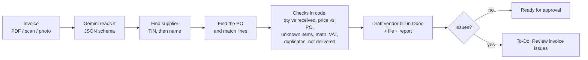

# Invoice Match Agent

An AI accounts-payable agent that plugs into an **Odoo ERP**. It reads supplier invoices (clean PDFs, office scans,
phone photos), checks each one against **what was ordered** and **what actually arrived** (a 3-way match), explains
every problem in plain language, and creates a **draft vendor bill** for a person to approve.

Built for **Lakan Distribution Inc.**, a fictional Philippine grocery distributor, on a self-hosted Odoo 19 with
synthetic invoices. No real company data.

**Held-out result** (40 invoices never seen while building, scored once, nothing changed afterwards):

| | |
|---|---|
| Problem invoices sent to review | **28/28 (100%)** |
| Planted billing errors caught, across all 8 types | **32/32 (100%)** |
| Flags that were real problems | 32/33 (97%) |
| Correct final routing (ready vs. needs review) | **39/40 (98%)** |
| Time per invoice | ~2.7 s median |

The one miss was a Google API timeout on a correct invoice, which the agent sent to a person instead of approving.

## The problem

Before paying a supplier, accounts payable checks three documents against each other:

| Document | Says |
|---|---|
| **Purchase order** | What we agreed to buy, at what price |
| **Goods receipt** | What actually arrived at the warehouse |
| **Supplier invoice** | What the supplier is charging |

When they don't match, money leaks: paying for 25 boxes when 15 arrived, paying a price above the agreed one,
paying the same invoice twice, paying for goods that haven't been delivered. In the scenario
([`docs/scoping.md`](docs/scoping.md)), two clerks type 300–500 invoices a month into Odoo by hand and then
check them. The invoices arrive as PDFs, scans and phone photos.

Odoo Community can check billed quantities against received ones, but only after someone has typed the bill in,
and it doesn't check prices, unknown items, math or duplicates. This agent does the reading and all of those checks.

## What it does



| Check | Example message from the agent |
|---|---|
| Over-billed quantity | *Pancit Canton Chilimansi 60g (box of 72): billed 25, only 15 received.* |
| Price mismatch | *Iced Tea Lemon 1L (case of 12): billed ₱621.00/unit, PO price is ₱540.00.* |
| Unknown item | *'Coffee Mix Original 20g x30' is billed but isn't on P00062.* |
| Duplicate invoice | *Bulacan Canned Goods Distributors invoice SI-2026-02124 was already received. Possible double payment.* |
| Not yet delivered | *Nothing on P00022 has been received yet; don't pay before the goods arrive.* |
| Math / VAT | *12% VAT on ₱64,025.00 is ₱7,683.00, invoice says ₱9,603.75.* |
| Wrong PO reference | *Invoice cites PO P00011, but its items and quantities match P00035.* |
| Missing PO reference | *No PO reference on the invoice. Best match by items and quantities: P00013.* |
| Suspicious date | *Invoice date 2026-05-09 is before the PO date 2026-08-30; check it was read correctly.* |

Every invoice, including unreadable ones, becomes a **draft** bill in Odoo with the original file attached, each line
linked to its PO line (so Odoo's own billed-quantity tracking stays correct), the match report in the notes, and a
To-Do when it needs a person. **Nothing is ever posted or paid by the agent.**

## Design principles

1. **AI for reading, code for money.** Gemini only turns the document into structured data. Every comparison of
   quantities, prices and totals is plain Python, so it's predictable, testable and explainable.
2. **Draft, never post.** The agent prepares the bill; a person approves it.
3. **Fail safe.** If anything can't be read or matched, the invoice goes to a person instead of passing.
4. **Explain every flag** with the numbers that triggered it.

## How it was tested

There's no real client data, so I built a realistic test environment and a way to score against it.

- **Odoo sandbox** ([`scripts/reset_sandbox.sh`](scripts/reset_sandbox.sh)): Odoo 19 + Postgres in Docker, set up as
  Lakan Distribution with the Philippine chart of accounts, PHP and 12% VAT; 8 suppliers, 32 grocery products and
  120 purchase orders (68 fully received, 30 partly received, 22 not yet received). Rebuilds identically in ~2 minutes.
- **Two names per product.** Lakan's PO says `BEV-001` "Cola 1.5L (case of 12)"; the supplier's invoice says
  `PBT-CL15-12` "Cola Litro 1.5L x12". Matching those is part of the job, as it is in real companies.
- **Invoice generator** ([`generator/`](generator/)): builds supplier invoices from the actual POs and receipts,
  plants errors, and writes an answer key for each. Three supplier layouts (item codes in a column, inside the
  description, or missing; different labels and date formats) and three forms: clean PDF, office scan and phone photo.
  Samples: [`docs/samples/`](docs/samples/).
- **Two sets:** 60 invoices for tuning and 40 held out, built from **separate POs**. Each error type has a fixed
  quota so rare types still get several examples.
- **Two evaluations:** [`evals/extraction.py`](evals/extraction.py) scores every field Gemini reads;
  [`evals/matching.py`](evals/matching.py) scores the checks, once with perfect data (logic only) and once with
  Gemini's real output (whole pipeline). Every run is saved in [`docs/eval_runs/`](docs/eval_runs/).

## Results

### Reading invoices (tuning set, 60)

| Prompt | Invoices read fully correctly | PDF | Scan | Photo |
|---|---|---|---|---|
| v1 | 83% | 85% | 78% | 90% |
| v2 (Philippine date rule) | **95%** | **100%** | 91% | 90% |

### Matching and routing

| | Tuning, perfect data | Tuning, full pipeline | **Held-out, full pipeline** |
|---|---|---|---|
| Planted errors caught | 100% (50/50) | 96% (48/50) | **100% (32/32)** |
| Flags that were real | 100% | 96% | **97%** |
| Problem invoices sent to review | 100% | 100% (42/42) | **100% (28/28)** |
| Correct invoices passed | 100% | 94% | **92% (11/12)** |
| Correct PO identified | 100% | 97% | **98%** |
| Correct final routing | 100% | 98% | **98% (39/40)** |

Every full-pipeline miss, in both sets, traces back to a Google API timeout, and each one failed safe.
Of the held-out invoices Gemini actually answered, 39/39 were read with every field correct.

### Against the scoping targets

| Target from [`docs/scoping.md`](docs/scoping.md) | Goal | Held-out result |
|---|---|---|
| Planted-error recall | ≥ 90% | **100%** |
| False alarms on correct invoices | ≤ 10% | **8%** (1 of 12, an API timeout) |
| PO match accuracy | ≥ 95% | **98%** |
| Time per invoice | < 30 s | **~2.7 s** |
| Money decisions made by the AI alone | 0 | **0** |

**Cost:** about 1,300 input and 400 output tokens per invoice on Gemini Flash-Lite. At listed Flash-Lite prices
that's a fraction of a peso per invoice (check current pricing); the whole project ran on the free tier.

## What went wrong and what I changed

Full list: [`docs/failure_log.md`](docs/failure_log.md). The ones that mattered most:

**1. Dates read with day and month swapped (9 of 60 invoices).**
`10/03/2026` was read as March 10 instead of October 3. Philippine invoices use month/day/year, and the model
assumed day/month. In AP this breaks payment terms and duplicate checks. One prompt rule took invoices read fully
correctly from 83% to 95%, and a code check now flags any invoice dated before its own PO.

**2. The agent accused invoices of citing the wrong PO (unknown items caught: 0 of 7).**
When a supplier added an item that wasn't ordered, the cited PO no longer covered every line, so the matcher picked a
different PO and raised a false "wrong PO" plus fake over-billing flags. Fix: trust the printed PO unless another PO
fits **exactly** (every item and quantity). Recall went from 86% to 100% and precision from 74% to 100% on
perfect data.

**3. The main model went down mid-project.**
Gemini Flash returned "high demand" errors and timed out, the same thing that happened in my
[inquiry triage project](https://github.com/hokors/inquiry-triage-automation). Flash-Lite answered in about 2 s
and read 95–98% of invoices fully correctly, so it became the main model with Flash as the fallback. Timeouts still cost one or two
invoices per run; each goes to a person.

**4. A duplicate slipped through because its original was never read.**
If the first copy of an invoice fails to extract, there's no invoice number on record to compare the second copy
against. Write-back now records every invoice, even unreadable ones, as a draft with an "Enter invoice manually"
To-Do. Still open: duplicates of an *unreadable* original.

Plus the usual integration surprises: an Odoo 19 field rename broke the seed script, Docker needed WSL and a restart,
and random error sampling starved rare error types until I switched to fixed quotas.

## Design decisions

| Decision | Why |
|---|---|
| Rules, not an LLM, for every money check | Predictable, testable, and explainable to an auditor. The LLM can't "decide" a price is fine. |
| Fuzzy name matching with `difflib`, no LLM | Supplier codes match most lines; plain string similarity handles the rest at zero cost. No case in the test sets needed more. |
| Trust the printed PO unless another fits exactly | Wrongly accusing a supplier costs time and trust; this rule removed every false "wrong PO" flag. |
| Flash-Lite main, Flash fallback | Faster, cheaper and far more available during the project; its reading accuracy (98% held-out) was good enough. Flash wasn't benchmarked on the full set because it kept timing out. |
| Draft bills only, linked to PO lines | A person stays accountable for payment, and Odoo's own records stay consistent. |
| Synthetic data with answer keys | Every number in this README can be reproduced; no client data was needed or exposed. |
| Held-out set from separate POs, run once | The tuning score is optimistic by design; the held-out score is the honest one. |

## Limits

- Synthetic invoices only. Real invoices bring handwriting, stamps, multi-page documents, credit notes and
  suppliers without POs, none of which are tested here.
- 100 test invoices is small; treat the rates as strong signals, not precise figures.
- VAT check is a flat 12%; withholding tax, VAT-exempt and zero-rated items aren't handled.
- Gemini timeouts happen; a production version needs a retry queue instead of giving up after a few minutes.
- Invoices are read from a folder; email or Viber intake isn't built.

## Next steps

- Retry queue for failed extractions, and duplicate detection by amount and date when the invoice number is unreadable.
- Real invoices from a partner company (anonymized), then measure hours saved per month.
- Email inbox intake, and an Odoo module so clerks can trigger the agent from the bill screen.

## Repo layout

| Path | What's in it |
|---|---|
| `agent/` | The agent: Odoo client, Gemini client, extraction, matching, write-back, `run.py` |
| `prompts/extract_invoice.md` | Extraction instructions |
| `schema/invoice.schema.json` | Fields Gemini must return |
| `generator/` | Synthetic invoice generator (layouts, scan/photo effects, planted errors, answer keys) |
| `evals/` | Extraction and matching evaluations |
| `scripts/` | Odoo sandbox setup and seed data |
| `docs/scoping.md` | Client-style scoping document |
| `docs/failure_log.md` | Every problem found, its cause and the fix |
| `docs/eval_runs/` | Every evaluation run, with per-invoice CSVs |
| `docs/samples/` | Example invoices with answer keys |

## Run it yourself

Needs Docker Desktop, Python 3 (tested on 3.14) and a Gemini API key.

```bash
cp .env.example .env
```

Set `PG_PASSWORD` and `GEMINI_API_KEY` in `.env`, then start Odoo and build the fictional company:

```bash
docker compose up -d
```

```bash
bash scripts/reset_sandbox.sh
```

This deletes and rebuilds the `lakan` database and writes an Odoo admin password and API key into `.env`.
Odoo is at http://localhost:8069.

```bash
pip install -r requirements.txt
```

Generate the test invoices:

```bash
python -m generator.generate --set tune --count 60
```

```bash
python -m generator.generate --set holdout --count 40
```

Evaluate:

```bash
python -m evals.extraction --set tune --label my-run --models gemini-flash-lite-latest gemini-flash-latest
```

```bash
python -m evals.matching --set tune --source my-run
```

Run the agent on a folder of invoices (creates draft bills in Odoo):

```bash
python -m agent.run path/to/invoices/
```

`--dry-run` shows the reports without writing. `--remove-drafts` deletes the agent's draft bills; the evaluation
scripts refuse to run while vendor bills exist, so scores stay reproducible.
