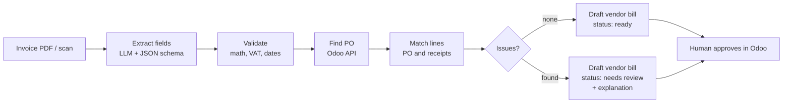

# Invoice Match Agent

An AI accounts-payable agent that plugs into an **Odoo ERP**. It reads supplier invoices (clean PDFs, scans, phone
photos), finds the matching purchase order, checks the invoice against **what was ordered and what was actually
received** (3-way match), explains every mismatch and creates a **draft vendor bill** for a person to approve.

> Status: planning. Built against a self-hosted Odoo 19 Community instance with a fictional company and synthetic
> invoices. No real company data.

## The problem

Finance teams pay suppliers by checking three documents against each other:

| Document | Says |
|---|---|
| **Purchase order (PO)** | What we agreed to buy, at what price |
| **Goods receipt** | What actually arrived at the warehouse |
| **Supplier invoice** | What the supplier is charging us |

If they don't match, the company can overpay: billed for 50 units when 40 arrived, a price higher than agreed,
the same invoice paid twice. Checking this by hand is slow, and mistakes cost real money.

Odoo has basic 3-way matching built in, but only on **quantities**, and only **after** someone has typed the invoice
in by hand. This agent does the part before that, and checks more:

- reads invoices in any layout, including scans and photos
- finds the right PO even when the invoice has no PO number or a wrong one
- matches invoice lines to PO lines when product names differ ("Coke 1.5L x12" vs "Coca-Cola 1.5 L Case")
- checks quantities **and** unit prices, totals, VAT and duplicates
- explains each issue in plain language and never posts or pays anything on its own

## How it will work



## What counts as an issue

| Check | Example |
|---|---|
| Over-billed quantity | Invoiced 50, received 40 |
| Price mismatch | ₱1,200/unit vs ₱1,000 on the PO |
| Unknown item | Invoice line not on the PO |
| Wrong or missing PO | PO number absent, or belongs to another supplier |
| Duplicate invoice | Same supplier + invoice number (or same amount and date) already billed |
| Math / VAT error | Line totals or 12% VAT don't add up |
| Not yet received | Invoice arrives before any goods receipt |

## Evaluation plan

Synthetic invoices generated from the Odoo POs, with **planted errors** from the table above, in several layouts
(clean PDF, scanned, phone photo, multi-page). Each invoice has an answer key.

| Metric | Meaning |
|---|---|
| Field extraction accuracy | Supplier, invoice no., date, PO no., lines, totals read correctly |
| PO match accuracy | Linked to the right PO |
| Issue recall | % of planted errors caught |
| Issue precision | % of flagged issues that are real (false alarms waste time) |
| Clean pass rate | % of correct invoices that go through with no false flags |
| Latency and cost | Per invoice |

Same approach as [inquiry-triage-automation](https://github.com/hokors/inquiry-triage-automation): a tuning set to
improve on, a held-out set scored once.

## Milestones

- [x] **Odoo sandbox:** Odoo 19 + Postgres in Docker, JSON-2 API, and Lakan Distribution's data: PH chart of accounts, PHP, 12% VAT, 8 suppliers, 32 products, 30 POs (16 fully received, 8 partial with backorders, 6 not yet received)
- [ ] **Invoice generator:** synthetic invoices with planted errors and answer keys
- [ ] **Extraction:** invoice → JSON, scored per field
- [ ] **Matching engine:** PO lookup, line matching, issue detection (rules + LLM only where needed)
- [ ] **Write-back:** draft vendor bills in Odoo with the explanation attached
- [ ] **Evaluation:** tuning and held-out runs
- [ ] **Case study + demo**

## Stack

| Part | Plan |
|---|---|
| ERP | Odoo 19 Community, self-hosted with Docker ([`compose.yaml`](compose.yaml)). JSON-2 external API verified working on self-hosted Community. |
| Extraction | Gemini with a JSON response schema ([`schema/invoice.schema.json`](schema/invoice.schema.json)) |
| Agent | Python, talking to Odoo's external API |
| Matching | Deterministic rules for money and quantities; LLM only for fuzzy product-name matching and explanations |

See [`docs/scoping.md`](docs/scoping.md) for scope, assumptions and risks, written as if for a client.

## Run the Odoo sandbox

Needs Docker Desktop.

```bash
cp .env.example .env
```

Set `PG_PASSWORD` in `.env`, then:

```bash
docker compose up -d
```

```bash
bash scripts/reset_sandbox.sh
```

This **deletes and rebuilds** the `lakan` database as Lakan Distribution Inc.
([`setup_company.py`](scripts/odoo/setup_company.py), [`seed_lakan.py`](scripts/odoo/seed_lakan.py)),
and writes a fresh admin password and API key into `.env`. Odoo is then at http://localhost:8069.

Each product has Lakan's own name and SKU (shown on POs) and the supplier's own name and code for it (what
supplier invoices print), e.g. supplier `PBT-CL15-12` "Cola Litro 1.5L x12" is Lakan's `BEV-001`
"Cola 1.5L (case of 12)". Matching those is part of the agent's job.
The agent uses Odoo's JSON-2 API: `POST /json/2/<model>/<method>` with `Authorization: bearer <key>`
and `X-Odoo-Database: lakan`.
